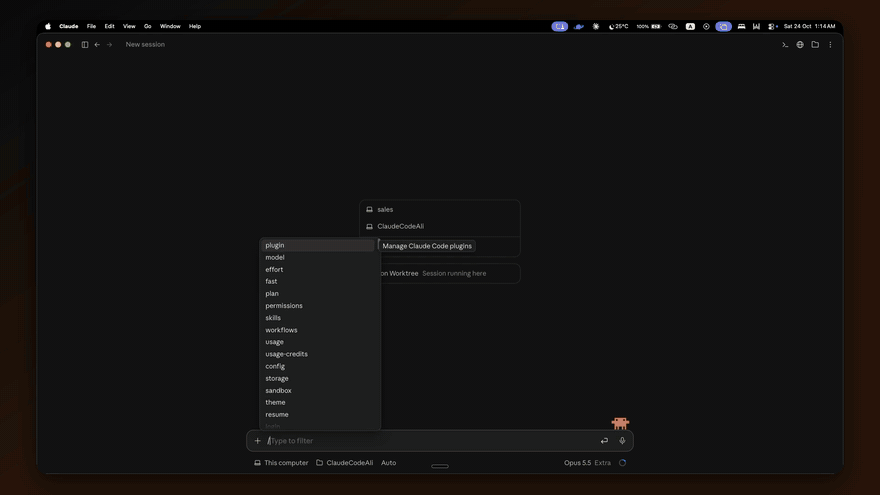
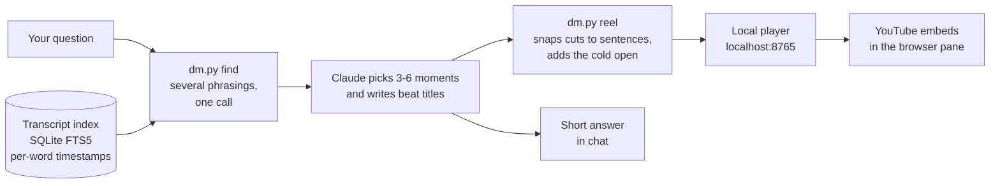

<h1 align="center">Dalton + Michael</h1>

<p align="center">
  Ask a startup question in Claude Code.<br>
  Get the answer from Dalton Caldwell and Michael Seibel, cut from their real videos and playing right next to your chat.
</p>

<p align="center">
  <a href="#install">Install</a> ·
  <a href="#usage">Usage</a> ·
  <a href="#how-it-works">How it works</a> ·
  <a href="docs/demo.mp4">Demo with sound</a>
</p>

<p align="center">
  
  
  
  
</p>

<p align="center">
  
</p>
<p align="center"><sub>20-second preview. <a href="docs/demo.mp4">Watch the full 49-second demo with sound</a>.</sub></p>

---

## What it does

`/dalton-michael Should I pivot my startup?` and about half a minute later:

- **A reel plays beside your chat.** A "great question" cold open, a smash cut into the episode where they cover it, then 3 to 6 moments where they actually answer, with a beat title over each one and live word-by-word captions.
- **Claude answers in chat.** A one-line verdict and a few bullets, one per point they made.
- **Nobody puts words in their mouths.** Every line attributed to Dalton or Michael is a real clip at a real timestamp. Claude writes the titles and the summary, and they're labelled as Claude's.
- **Silly questions get the answer they deserve.** Ask whether eating pizza gets you more customers and you get five seconds of "No." from them.

It searches every video of YC's *Dalton & Michael* series (2019 to 2024), their own *Dalton + Michael* channel (2025 onward), and 18 solo YC talks by one of them: **106 videos, about 32 hours**.

## Install

You need [Claude Code](https://claude.com/claude-code) (the desktop app plays reels in its built-in browser pane; the CLI opens your default browser), Python 3.9+, and [yt-dlp](https://github.com/yt-dlp/yt-dlp).

**1. Clone it into your skills folder**

```bash
git clone https://github.com/AKamaly/dalton-michael-skill ~/.claude/skills/dalton-michael
```

**2. Install yt-dlp**

```bash
brew install yt-dlp
```

(or `pip install yt-dlp`)

**3. Build the transcript index (once)**

```bash
python3 ~/.claude/skills/dalton-michael/scripts/dm.py ingest
```

This takes about 30 minutes the first time, because YouTube rate-limits caption downloads and the script backs off politely. It downloads captions only, never video. Run it again whenever you want new episodes; it skips what it already has.

## Usage

In Claude Code, type the command and your question:

```
/dalton-michael Should I pivot my startup?
```

or just say *"ask Dalton and Michael: should I raise or bootstrap?"*.

| Real questions | Questions with the funniest openers | Questions that get "No." |
|---|---|---|
| How do I sell to customers? | How do I win? | Does eating pizza get me more customers? |
| Should I bootstrap or raise VC? | Does my startup need to be in San Francisco? | Should my cat be my CTO? |
| Am I undercharging? | Will OpenAI kill my startup? | Can I pay my employees in shawarma? |
| How do I sell AI to skeptical customers? | How do founders actually get rich? | Do I need a yacht before Series A? |
| Is my startup a zombie? | | |

Add your own context for a sharper cut: *"We have 3 pilots and none convert to paid. Am I undercharging?"* After it plays, steer it: *"make it shorter"*, *"only the 2026 episodes"*, *"show me where they disagree"*.

Every reel you make stays in the player's history menu.

## How it works



1. **Index.** `ingest` pulls YouTube's auto-captions as json3, which carry a timestamp for every word and a marker at every speaker change. They're split into sentences and overlapping 60-second passages in a SQLite FTS5 index.
2. **Find.** `find` runs several phrasings of your question at once, merges them with reciprocal rank fusion, keeps at most 3 hits per video, and prints each hit as timestamped sentences, so Claude can choose cut points without reading anything else.
3. **Cut.** Claude picks the moments, preferring the two-person episodes so both of them are heard. Cut points snap to sentence boundaries, and a "great question" sting from a curated bank becomes the cold open.
4. **Play.** The player is a single HTML page that uses the YouTube IFrame API:
   - **Two players.** While one clip plays, a hidden second player buffers the next one and starts rolling five seconds early. The cut is then an instant swap, and YouTube's own pause icon has already faded.
   - **Live captions.** Captions are drawn from the word timings, karaoke style, and the beat title slides over the top of the picture.
   - **Polite in the background.** A reel waits until it's on screen before it autoplays, and pauses when its tab is hidden.

## Commands

All commands are `python3 ~/.claude/skills/dalton-michael/scripts/dm.py <command>`. Claude runs them for you; they're here if you're curious.

| Command | What it does |
|---|---|
| `find Q1 Q2 ... [-n N]` | Several queries at once, hits as timestamped sentences |
| `show VIDEO 4:10 5:20` | Read any window of a transcript |
| `reel spec.json` | Build a reel from a list of clips and print its URL |
| `silly "question"` | The five-second "No." reel |
| `reactions` | The curated cold-open bank |
| `ingest` / `index` | Pull new episodes, rebuild the index |
| `stats` | Corpus size |

## Files

```
SKILL.md              the instructions Claude follows
scripts/dm.py         index, search, reel builder, local server (stdlib only)
player/index.html     the reel player
data/reactions.json   curated cold opens and "No." clips
docs/                 icon, demo video, preview GIF
```

`ingest` creates `data/captions/`, `data/index.sqlite`, and `data/videos.json` locally. They're gitignored, and so are your reels.

## Recording a demo

Recording a screencast and don't want your own company showing up in the answers? Turn on recording mode and the answers stay generic:

```bash
touch ~/.claude/skills/dalton-michael/data/RECORDING
```

Delete that file to turn it off. The demo above was recorded on macOS with [Recordly](https://github.com/webadderallorg/Recordly)'s ScreenCaptureKit recorder, built from source and driven from the command line, with the questions typed by AppleScript and the cut made with ffmpeg. Claude did all of it.

## Notes

- **No video is ever downloaded.** Clips stream from YouTube's embed player, so views count and every clip links to the full episode.
- **Why a local server?** YouTube embeds need a real http origin, so the player runs on `localhost:8765`. The `reel` command starts it on its own.
- **Speaker names.** Captions mark speaker changes, not who is talking, so clips are only labelled with a name in solo talks.
- **Platforms.** Built and tested on macOS. Linux should work. Windows is untested.

## Disclaimer

This is an unofficial fan project. It isn't affiliated with or endorsed by Dalton Caldwell, Michael Seibel, Y Combinator, or Standard Capital. All video belongs to its owners and plays from YouTube. Transcripts are fetched by each user locally and never redistributed here.

Thank you, Dalton and Michael, for years of free office hours.

## License

MIT for the code. See [LICENSE](LICENSE).
